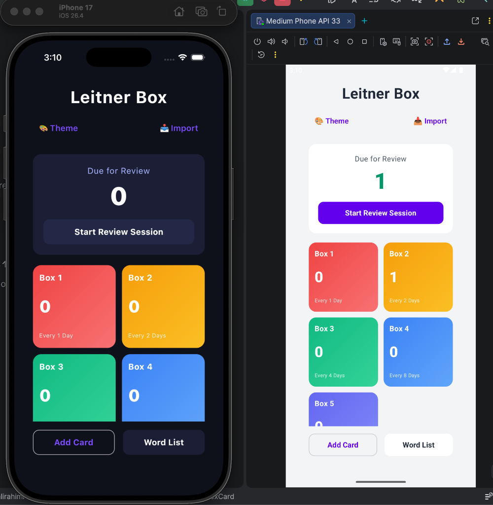
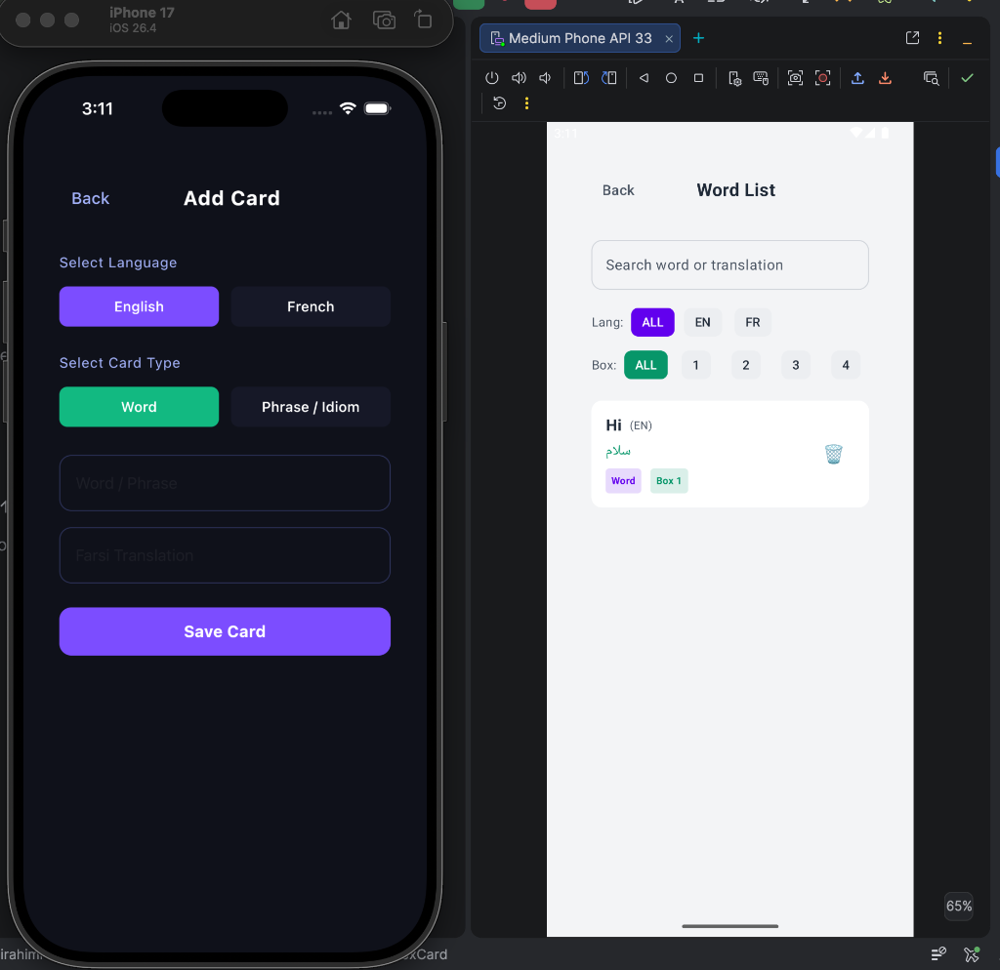

# FlashCard Learning (Leitner System)

An offline-first, modern Leitner Box spaced repetition flashcard application built using **Kotlin Multiplatform (KMP)** and **Compose Multiplatform**. It is specifically designed to help IELTS and language students memorize English and French vocabulary with Persian translations.

---

## Key Features

- **Leitner Spaced Repetition**: 5 progressive boxes with exponential delay intervals (1 day, 2 days, 4 days, 8 days, 16 days). Correct answers move cards forward, while incorrect answers reset them to Box 1.
- **Persistent Theming (Dark, Light & Custom)**: Switch seamlessly between Dark, Light, and tinted Custom color themes with automatic status/navigation bar adaptation. Theme preferences are persisted locally (`SharedPreferences` on Android, `NSUserDefaults` on iOS).
- **Dynamic Keyboard Language Auto-Switching**: When adding cards, the device keyboard automatically switches to English/French when focusing on the vocabulary input, and to Persian when focusing on the translation field.
- **Bulk Word Import**: Import lists of flashcards in bulk. Users can copy-paste text (supporting separators like `->`, ` - `, `:`, and `=`) or pick `.txt` files directly using native file pickers on Android and iOS. Existing and intra-batch duplicates are automatically detected and skipped.
- **Type-Safe Navigation & Smooth UX**: Powered by Compose Navigation with `@Serializable` routes, native back stack handling, tap-outside keyboard dismissal (`clearFocusOnTap`), `SavedStateHandle` form restoration across process death, and `graphicsLayer`-based review animations without transition-flashing bugs.
- **Adaptive UI & Custom App Icon**: The dashboard, lists, and forms scale fluidly across phones and tablets, paired with a custom layered-flashcard app icon for both Android (Adaptive Icon) and iOS.
- **Offline-First & Local Persistence**: Data is persisted locally using **SQLDelight** on SQLite, requiring zero internet connection or remote servers.
- **Clean Architecture & MVI**: Feature-layered package structure (`core` + `feature`), unidirectional MVI state management, typed `Result<D, E>` error handling, and full unit test coverage.

## Screenshots

<p align="center">
  
  
</p>

---

## Architecture & Design Patterns

The codebase follows **Clean Architecture** with **MVI (Model-View-Intent)** and feature-layered packaging (`presentation → domain ← data`):

```
┌────────────────────────────────────────────────────────┐
│              Presentation Layer (MVI)                  │
│   Root / Screen Split, State, Action, Event, NavGraph  │
└───────────────────────────┬────────────────────────────┘
                            ▼
┌────────────────────────────────────────────────────────┐
│                      Domain Layer                      │
│   Use Cases, DataSource Contracts, Result<D, E>, Error │
└───────────────────────────┬────────────────────────────┘
                            ▼
┌────────────────────────────────────────────────────────┐
│                       Data Layer                       │
│   SqlDelightCardDataSource, Mappers, Theme Prefs       │
└────────────────────────────────────────────────────────┘
```

- **Presentation Layer (MVI)**: Every screen defines a single `State` data class (updated via `.update {}`), `Action` sealed interface, `Event` channel (`ObserveAsEvents`), and a `Root`/`Screen` composable split using `collectAsStateWithLifecycle()` and `koinViewModel()`. Errors map cleanly to localized Compose Resources via `UiText`.
- **Navigation**: Type-safe Compose Navigation with `@Serializable` routes (`DashboardRoute`, `AddCardRoute`, `CardListRoute`, `ReviewRoute`, `ImportRoute`) and per-feature `NavGraphBuilder` extensions assembled in `App.kt`.
- **Domain Layer**: Pure Kotlin models, `CardLocalDataSource` / `ThemePreferencesDataSource` interfaces, typed `Result<D, E>` & `DataError`, and single-responsibility use cases (`AddCardUseCase`, `GetAllCardsUseCase`, `DeleteCardUseCase`, `GetCardsForReviewUseCase`, `ReviewCardUseCase`, `ImportCardsUseCase`).
- **Data Layer**: `SqlDelightCardDataSource` wraps SQLite calls into typed `Result<T, DataError.Local>`, alongside top-level entity mappers and platform theme preferences.
- **Dependency Injection**: **Koin 4** with layer/feature DI modules using `singleOf`, `factoryOf`, and `viewModelOf`, initialized in `FlashCardApplication` (Android) and `IosKoin` (iOS).

---

## Tech Stack

- **Framework**: Kotlin Multiplatform (KMP) & Compose Multiplatform
- **Navigation**: Type-Safe Compose Navigation (`navigation-compose`)
- **Database & Persistence**: SQLDelight (SQLite drivers), SharedPreferences / NSUserDefaults
- **Dependency Injection**: Koin 4 (`koin-core`, `koin-compose`, `koin-compose-viewmodel`)
- **Concurrency**: Kotlin Coroutines & Flow
- **Serialization**: kotlinx.serialization
- **Testing**: Kotlin Test, `kotlinx-coroutines-test`, Turbine, AssertK

---

## Project Structure

```
├── androidApp                      # Android Entry Point (FlashCardApplication, MainActivity, Adaptive Icon)
├── iosApp                          # iOS Swift Entry Point, LanguageTextField & Xcode Project
└── shared                          # Shared Kotlin Multiplatform Module
    ├── src/commonMain/kotlin/.../
    │   ├── App.kt                  # AppTheme + Type-Safe NavHost assembly
    │   ├── di/                     # Koin module assembly (AppKoin)
    │   ├── core/
    │   │   ├── domain/             # Result, Error, DataError, FlashCard, DataSource interfaces
    │   │   ├── data/               # SqlDelightCardDataSource, Mappers, SystemTimeProvider, DI
    │   │   ├── presentation/       # UiText, ObserveAsEvents, ObserveLifecycle, clearFocusOnTap
    │   │   └── designsystem/       # AppTheme, ThemeController, reusable Material3 components
    │   └── feature/
    │       ├── dashboard/          # Dashboard MVI screen, ViewModel, nav graph
    │       ├── cards/              # AddCard & CardList domain + MVI presentation
    │       ├── review/             # Leitner review domain + MVI presentation
    │       └── importcards/        # Bulk import domain + MVI presentation + FilePicker
    ├── src/androidMain             # Android SQLite driver, SharedPreferences, TextField & FilePicker
    └── src/iosMain                 # iOS SQLite driver, NSUserDefaults, UIKit TextField & DocumentPicker
```

---

## Getting Started

### Prerequisites
- Xcode (for iOS build)
- Android Studio / IntelliJ IDEA with KMP plugin
- JDK 17+

### Running the Apps

#### Android Application
To build and assemble the debug APK:
```bash
./gradlew :androidApp:assembleDebug
```

#### iOS Application
1. Open `iosApp/iosApp.xcodeproj` in Xcode.
2. Select your target simulator (e.g., iPhone 17).
3. Click **Run** or use command line:
```bash
xcodebuild -project iosApp/iosApp.xcodeproj -scheme iosApp -configuration Debug -sdk iphonesimulator -arch arm64 build
```

### Running Tests
Unit and integration tests cover all Use Cases, ViewModels (with `UnconfinedTestDispatcher`, Turbine, AssertK, `SavedStateHandle`, and in-memory fakes), `ThemeController`, Koin DI graph, and `SqlDelightCardDataSource`.

- **Run Android/JVM host tests**:
  ```bash
  ./gradlew :shared:testAndroidHostTest
  ```
- **Run iOS simulator tests**:
  ```bash
  ./gradlew :shared:iosSimulatorArm64Test
  ```

---

# جعبه لایتنر فلش کارت (Kotlin Multiplatform)

یک اپلیکیشن مدرن فلش کارت لایتنر (تکرار فاصله‌دار) آفلاین، توسعه داده شده با **Kotlin Multiplatform (KMP)** و **Compose Multiplatform**. این برنامه مخصوصاً برای کمک به دانشجویان آیلتس و زبان‌آموزان جهت یادگیری لغات انگلیسی و فرانسوی با ترجمه فارسی طراحی شده است.

---

## ویژگی‌های کلیدی

- **تکرار فاصله‌دار لایتنر**: دارای ۵ جعبه پیش‌رونده با فواصل زمانی نمایی (۱ روز، ۲ روز، ۴ روز، ۸ روز، ۱۶ روز). پاسخ‌های صحیح کارت‌ها را به جعبه بعدی هدایت می‌کنند و پاسخ‌های نادرست آن‌ها را به جعبه ۱ باز می‌گردانند.
- **تمینگ دائمی (تاریک، روشن و سفارشی)**: پشتیبانی از تم Dark، Light و رنگ‌های Custom با تغییر هماهنگ کل پالت رنگی و آیکون‌های Status Bar. انتخاب کاربر به‌صورت دائمی در حافظه دستگاه (`SharedPreferences` در اندروید و `NSUserDefaults` در iOS) ذخیره می‌شود.
- **تغییر خودکار زبان کیبورد**: هنگام وارد کردن کلمات، کیبورد به محض تمرکز روی فیلد کلمه به انگلیسی/فرانسوی و به محض تمرکز روی فیلد معنی به فارسی تغییر زبان می‌دهد.
- **ایمپورت گروهی لغات (Bulk Word Import)**: امکان وارد کردن انبوه فلش‌کارت‌ها از طریق کپی/پیست (با جداکننده‌های `->`، ` - `، `:` و `=`) یا انتخاب فایل `.txt` با انتخابگر نیتیو اندروید و iOS. کلمات تکراری (هم در دیتابیس و هم درون یک فایل) به‌صورت خودکار شناسایی و رد می‌شوند.
- **نویگیشن Type-Safe و تجربه کاربری روان**: استفاده از Compose Navigation با روت‌های `@Serializable`، بستن خودکار کیبورد با لمس پس‌زمینه (`clearFocusOnTap`)، حفظ ورودی فرم‌ها با `SavedStateHandle` و انیمیشن مرور بر پایه `graphicsLayer` بدون مشکل فلاش زدن معنی کارت بعدی.
- **رابط کاربری تطبیق‌پذیر و آیکون اختصاصی**: طراحی ریسپانسیو برای گوشی و تبلت همراه با آیکون اختصاصی برای اندروید (Adaptive Icon) و iOS.
- **کاملا آفلاین (Offline-First)**: ذخیره‌سازی محلی با **SQLDelight** روی SQLite بدون نیاز به اینترنت یا سرور.
- **معماری تمیز و MVI**: ساختار پکیج لایه‌بندی‌شده (`core` و `feature`)، مدیریت وضعیت یک‌طرفه MVI، مدیریت خطای تایپ‌شده با `Result<D, E>` و پوشش کامل تست‌های واحد.

## تصاویر برنامه

<p align="center">
  
  
</p>

---

## معماری و الگوهای طراحی

این پروژه با **معماری تمیز (Clean Architecture)**، الگوی **MVI** و ساختار پکیج لایه‌بندی‌شده بر اساس فیچر (`core` + `feature`) توسعه یافته است:

- **لایه ارائه (Presentation / MVI)**: هر صفحه دارای `State` یکتا، `Action`، `Event` (با `Channel` و `ObserveAsEvents`) و تفکیک کامپوزابل `Root`/`Screen` با `collectAsStateWithLifecycle()` و `koinViewModel()` است. پیام‌های خطا از طریق `UiText` و ریسورس‌های Compose نمایش داده می‌شوند.
- **نویگیشن (Type-Safe Navigation)**: تعریف روت‌های `@Serializable` و گراف نویگیشن مجزا برای هر فیچر که در `App.kt` به هم متصل می‌شوند.
- **لایه دامنه (Domain)**: شامل مدل‌های خالص، اینترفیس‌های DataSource، نوع `Result<D, E>` و `DataError` و Use Caseهای مجزا برای هر عملیات.
- **لایه داده (Data)**: پیاده‌سازی `SqlDelightCardDataSource` با نگاشت خطاهای دیتابیس به `DataError.Local`، مپرها و ذخیره‌سازی محلی تنظیمات تم.
- **تزریق وابستگی (Koin 4)**: تفکیک ماژول‌های Koin برای هر لایه/فیچر با `singleOf`، `factoryOf` و `viewModelOf` و راه‌اندازی در `FlashCardApplication` (اندروید) و `IosKoin` (iOS).

---

## نحوه اجرا و تست

### پیش‌نیازها
- سیستم‌عامل macOS با Xcode نصب شده (برای ساخت نسخه iOS)
- محیط Android Studio یا IntelliJ IDEA با پلاگین KMP
- جاوا نسخه JDK 17+

### اجرای برنامه‌ها

#### نسخه اندروید:
```bash
./gradlew :androidApp:assembleDebug
```

#### نسخه iOS:
پروژه موجود در مسیر `iosApp/iosApp.xcodeproj` را در Xcode باز کرده و اجرا کنید، یا از دستور زیر در ترمینال استفاده نمایید:
```bash
xcodebuild -project iosApp/iosApp.xcodeproj -scheme iosApp -configuration Debug -sdk iphonesimulator -arch arm64 build
```

### اجرای تست‌ها
تست‌های واحد و یکپارچه‌سازی با `UnconfinedTestDispatcher`، **Turbine**، **AssertK** و Fakeها تمام Use Caseها، ViewModelها، `ThemeController`، گراف Koin و `SqlDelightCardDataSource` را پوشش می‌دهند:

- **اجرای تست‌های اندروید/JVM**:
  ```bash
  ./gradlew :shared:testAndroidHostTest
  ```
- **اجرای تست‌های شبیه‌ساز iOS**:
  ```bash
  ./gradlew :shared:iosSimulatorArm64Test
  ```
